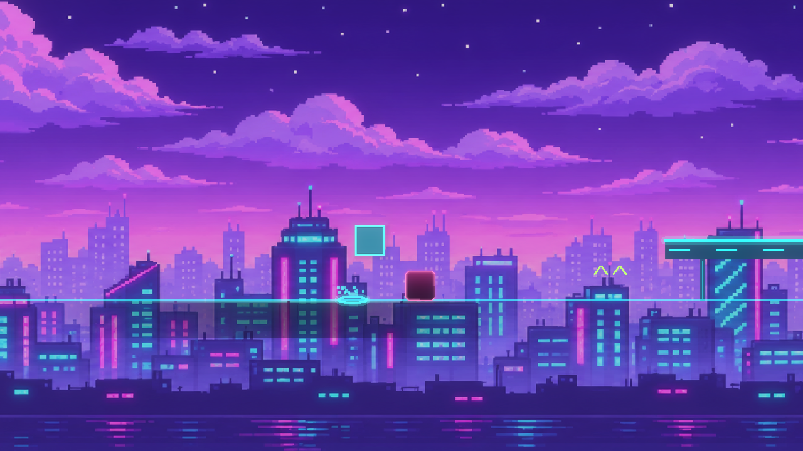

# NEON / LINK — Kamera ve radar girdili 2D platform oyunu

Laptop kamerasıyla hareket ederek oynanan, neon şehir temalı bir Unity prototipi.
OpenCV görüntüyü alır, MediaPipe vücut noktalarını çıkarır, Python hareketi değerlendirir
ve Unity'ye zıplama isteği gönderir. LD2450 radar girdisi de deneysel demo olarak korunur.



**Güncel gösterim — 25 Kasım 2026:** CAMERA girdisi, otomatik mesafe kalibrasyonu,
üç platformlu parkur, iki parçalı alçak platform, saydam zemin ve kısa neon kıvılcımları.

[Sunum rehberi ve hız/ivme açıklamaları](docs/2026-11-25-demo-guide.md) ·
[Unity kurulumu](unity/README.md) ·
[API / SQL kurulumu](backend/README.md) ·
[Radar deney notları](docs/radar-experiments.md)

## Neler var?

- Baş ve iki omuzun birlikte yükselişinden kamera hareket girdisi.
- Kameraya uzaklık belirgin değiştiğinde otomatik yeniden kalibrasyon.
- İlk kabul edilen zıplamayla başlayan otomatik ilerleme ve RETRY ile yeni tur.
- İlk platformdan yüksek ikinci platforma, ardından kesik alçak platformdan zemine inen parkur.
- Mor piksel şehir, aynı temada giriş ekranı, saydam zemin ve neon engeller.
- Zıplamada kıvılcım ve ışık halkası, inişte daha hafif bir efekt.
- ASP.NET Core / SQL Server ile hesaplar ve desteklenen kaynaklar için kayıtlı sonuçlar.

Bir bölüm oynanabilir; 02–05 geliştirme aşamasındadır. Ses ve müzik henüz eklenmedi.
Oyun arayüzü İngilizce, açıklayıcı kaynak yorumları Türkçedir.

## Nasıl çalışıyor?

```text
Kamera → OpenCV → MediaPipe → Python hareket kararı
       → UDP 127.0.0.1:5065 → Unity kaynak/olay/zemin kontrolü → Zıplama + efekt

Unity → HTTP localhost:5269 → Hesap API'si → SQL Server
```

API hesap işlemlerini ve desteklenen tur sonuçlarını taşır; zıplama isteği UDP ile gider.
Kamera antrenman skoru oyun ekranında gösterilir, mevcut API'ye kamera turu kaydedilmez.
Görüntü dosyası Unity'ye gönderilmez; yalnız zaman ve sıra bilgili olay iletilir.

## Gereksinimler

| Bileşen | Kullanılan ortam |
| --- | --- |
| İşletim sistemi | Windows; kamera uygulaması DirectShow kullanır |
| Oyun | Unity Editor **6000.6.7f1**, Unity Hub |
| Kamera girdisi | Python **3.12**, OpenCV, MediaPipe, web kamerası |
| Model | Proje kökünde `pose_landmarker_lite.task` |
| Hesap hizmeti | .NET **10**, SQL Server, `RadarPlatformGameDb` |
| İsteğe bağlı radar | LD2450, seri port ve PySerial |

Model Git dışında tutulur. Mevcut çalışan modelinizi veya
[Google Pose Landmarker Lite modelini](https://storage.googleapis.com/mediapipe-models/pose_landmarker/pose_landmarker_lite/float16/1/pose_landmarker_lite.task)
`main.py` ile aynı klasöre yerleştirin.

`requirements.txt` mevcut kamera ortamının sürüm listesidir; iki OpenCV dağıtımı içerir.
Temiz makinede kurulum ayrıca doğrulanmalıdır. Çalışan `.venv` ortamı varsa aşağıdaki
komutlar doğrudan o ortamı kullanır. Radar bağımlılığı ayrı `requirements-radar.txt` dosyasındadır.

## Kamera ile hızlı başlangıç

Aşağıdaki yollar mevcut çalışma klasörünü örnekler; başka konuma klonladıysanız kendi yolunuzu kullanın.

### 1. Hesap API'sini başlat

SQL Server hizmeti açık olsun. İlk kurulumda
[veritabanı şemasını](backend/database/01_create_database.sql) SSMS'te çalıştırın.
Veritabanı zaten varsa yeniden oluşturmayın. Ayrı PowerShell'de:

```powershell
Set-Location 'C:\Users\Dila\Documents\JumpDetectionTest\backend\RadarPlatformGame.Api'
dotnet run --launch-profile http
```

Terminal açık kalsın. `http://localhost:5269/api/health` yanıtında `status: ok` beklenir.
Bağlantı ve SQL ayarları [API belgesindedir](backend/README.md).

### 2. Kamera girdisini başlat

İkinci PowerShell'de:

```powershell
Set-Location 'C:\Users\Dila\Documents\JumpDetectionTest'
& '.\.venv\Scripts\python.exe' main.py --game-events --upper-body
```

Baş ve iki omuz kadrajda olsun. Yaklaşık bir saniye sabit durup **READY - JUMP** mesajını bekleyin.
Mesafe değiştiğinde yeniden sabit duruşla referans alınır. Kamera penceresi tur boyunca açık kalır.

### 3. Unity'den turu aç

1. Unity Hub'da `unity/RadarPlatformGame` klasörünü **6000.6.7f1** ile açın.
2. `Assets/Scenes/Prototype.unity` sahnesini açıp Editor'da **Play**'e basın.
3. Oyunda **PLAY → SIGN IN → CAMERA → START RUN** seçin.
4. Geri sayım bittikten ve kamera hazır olduktan sonra zıplayın.
5. Kare zemindeyken veya platformdayken sonraki zıplama uygulanır. **RETRY** yeni tur açar.

İlk uygulanabilir olay hem kareyi zıplatır hem ilerlemeyi başlatır.
Havada gelen ek istek inişte kullanılmak üzere bekletilmez.

## Girdi seçenekleri ve kontroller

| Seçenek | Girdi / kullanım |
| --- | --- |
| CAMERA | Python kamera penceresinden gelen üst gövde hareketi |
| KEYBOARD | Space ile zıplama; Python gerekmez |
| SIMULATION | Space / SIM JUMP düğmesi veya Python simülatör olayları |
| RADAR DEMO | Gerçek radar ölçümünden deneysel hareket adayı; zıplama dışındaki hareketler de tetikleyebilir |
| Kamera penceresinde R / Q | Kalibrasyonu ve sayacı sıfırla / kamerayı kapat |
| Oyunda RETRY / MENU / DEBUG | Yeni tur / bölüm seçimi / bağlantı ve kabul durumları |

Klavye, simülasyon ve radar çalıştırma ayrıntıları [Unity belgesinde](unity/README.md#python-girdileri).
Radarın seri port, kayıt, oyun alanı ve demo kuralları [radar deney notlarında](docs/radar-experiments.md).

## Kodda neresi neyi ayarlıyor?

Unity dosyaları `unity/RadarPlatformGame/Assets/` altındadır.

| Konu | Dosya / metot |
| --- | --- |
| Yatay hız, ilk zıplama hızı, yerçekimi çarpanı | [JumpPrototype.cs](unity/RadarPlatformGame/Assets/Scripts/JumpPrototype.cs): `moveSpeed`, `jumpSpeed`, `gravityScale` |
| Zıplama uygulama ve UDP kabulü | `JumpPrototype.FixedUpdate`, `ReceiveEvents`, `RequestJump` |
| Üç platform ve engellerin konumları | `JumpPrototype.Start`, `CreatePlatform`, `CreateObstacle` |
| Arka plan resmi | [NeonCityBackdrop.png](unity/RadarPlatformGame/Assets/Resources/NeonCityBackdrop.png) |
| Saydam gökyüzü, şehir kayması, engel görünümü ve efektler | [NeonStage.cs](unity/RadarPlatformGame/Assets/Scripts/NeonStage.cs) |
| Saydam zemin yüzeyi ve yerel ışık | `JumpPrototype.CreateStageSurface`, [ScreenSpotlight2D.shader](unity/RadarPlatformGame/Assets/Resources/ScreenSpotlight2D.shader) |
| Karenin çizimi, dönüşü ve platform teması | [PrototypeCharacter.cs](unity/RadarPlatformGame/Assets/Scripts/PrototypeCharacter.cs) |
| Giriş, hesap formu, bölüm seçimi ve HUD | [PrototypeInterface.cs](unity/RadarPlatformGame/Assets/Scripts/PrototypeInterface.cs) |
| Kameradan görüntü ve vücut noktalarını alma | [jump_detection/app.py](jump_detection/app.py) |
| Kalibrasyon ve hareket kararı | [jump_detection/game_detector.py](jump_detection/game_detector.py) |
| UDP olay gönderimi | [game_bridge/__init__.py](game_bridge/__init__.py) |
| Hesap / sonuç istemcisi ve sunucusu | [GameAccountClient.cs](unity/RadarPlatformGame/Assets/Scripts/GameAccountClient.cs), [backend/](backend/README.md) |

Varsayılan yatay hız **3.25 birim/s**, ilk yukarı hız **11.5 birim/s**, yerçekimi çarpanı **2.5**'tir.
Yatay ivmelenme eğrisi yoktur; hız doğrudan atanır. Dikey ivme yaklaşık **−24.53 birim/s²**'dir.
Kamera modunda havadaki yatay hız **3.9 birim/s** olur.
[Sunum rehberi](docs/2026-11-25-demo-guide.md) bu farkları, parkur ölçülerini ve karar akışını ayrıntılı açıklar.

## Doğrulama ve mevcut sınırlar

```powershell
python -m compileall -q main.py jump_detection radar game_bridge tests
python -m unittest discover -s tests -v
dotnet build backend/RadarPlatformGame.Api/RadarPlatformGame.Api.csproj
```

- 25 Kasım yerel kontrolde **106 Python testi** ve API derlemesi geçti.
- [GitHub Actions](https://github.com/dilanur-koc/JumpDetection-Python/actions/workflows/python-checks.yml) Python sözdizimini, donanımsız testleri ve .NET derlemesini çalıştırır.
- Yerel Unity fizik simülasyonunda üç platformlu rota tamamlandı; giriş ekranı, geniş ekran ve efektler görsel olarak kontrol edildi. Lisanslı Unity CI henüz yoktur.
- Kamera girdisi kullanıcı denemesinde çalıştı; farklı ortamlar ve kişiler için nicel başarı oranı henüz ölçülmedi.
- Üst gövde modu ayak temasını görmez; birlikte yükselen baş/omuz hareketini değerlendirir. Parmak ucuna yükselme gibi hareketler yanlış olay üretebilir.
- LD2450 düzlemsel hedef konumu/hızı verir; radar Y koordinatı dikey zıplama yüksekliği değildir. Radar sayımı deneysel hareket adayıdır.
- UDP gönderimi, paketin kabulü ve oyunda uygulanan zıplama ayrı sayılardır. Debug ekranı bunları ayrı gösterir.

## Belgeler ve görsel kaynak

- [25 Kasım sunum rehberi](docs/2026-11-25-demo-guide.md)
- [UDP olay sözleşmesi](docs/game-input-contract.md)
- [Geliştirme planı](docs/development-plan.md)
- [Önceki çalışma özeti — 5 Kasım](docs/2026-11-05-progress.md)
- [Antigravity çalışma notları](docs/antigravity-start.md)
- [Şehir görselinin üretim istemi](docs/art/neon-city-backdrop-prompt.txt)

Şehir panoraması, kullanıcı referanslarının renk ve piksel şehir havasından esinlenerek
yerleşik görsel üretme aracıyla hazırlanmıştır. Referans resimler oyuna kopyalanmamıştır.
Yerel kayıtlar, model, sanal ortam, Unity önbellekleri ve veritabanı dosyaları Git'e eklenmez.
