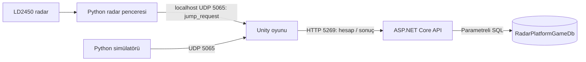

# 5 Kasım 2026 — NEON / LINK çalışma özeti

## Çalıştırma: hangi API açılacak?

Oyunun hesap ve sonuç hizmeti **RadarPlatformGame.Api** projesidir. Unity'den önce bir PowerShell penceresinde:

```powershell
Set-Location 'C:\Users\Dila\Documents\JumpDetectionTest\backend\RadarPlatformGame.Api'
dotnet run --launch-profile http
```

`Now listening on: http://localhost:5269` ve `Application started` görünmesi beklenir. Bu pencerenin beklemesi normaldir; hizmet istek bekler. Geliştirme sırasında pencere açık kalır. `Ctrl+C` veya pencereyi kapatmak API'yi durdurur. Aynı hizmeti ikinci pencereden yeniden başlatmak gerekmez.

Tarayıcıdan bağlantı kontrolü: **http://localhost:5269/api/health**. Beklenen yanıt:

```json
{"status":"ok","database":"RadarPlatformGameDb"}
```

Bu kontrol sadece API ve SQL bağlantısını sınar; oyunu veya radarı başlatmaz. SQL Server hizmeti çalışmalıdır; SSMS penceresinin açık kalması gerekmez. Veritabanı bu bilgisayarda zaten oluşturuldu. Başka bilgisayarda ilk kurulum için `backend/database/01_create_database.sql` SSMS'te bir bütün olarak çalıştırılır. API tabloları kendi kendine oluşturmaz.

Unity Hub'da açılacak klasör:

```text
C:\Users\Dila\Documents\JumpDetectionTest\unity\RadarPlatformGame
```

Editor sürümü **6000.6.7f1**. Sahne `Assets/Scenes/Prototype.unity`; gerekirse **Radar → Oyun sahnesini ac veya olustur** menüsünden açılır. Play → Play → Sign in → Select a run → giriş kaynağını seç → Start run. Üç saniyelik hazırlıktan sonra parkur başlar.

## Veri akışı



İki ayrı bağlantı vardır. **UDP 5065** hareket adaylarını Unity'ye taşır. **HTTP 5269** giriş, profil, sonuç ve ilerlemeyi taşır. Unity doğrudan SQL'e bağlanmaz. API radarın her ölçümünü veya her zıplamayı veritabanına yazmaz; tamamlanan/kaybedilen turun sonucunu kaydeder.

## Hesap, API ve SQL

- Kullanıcı adı ve şifreyle kayıt/giriş eklendi. Ad 3–32, şifre 8–128 karakter olmalıdır.
- Şifre açık metin tutulmaz. API `PasswordHasher` ile rastgele salt içeren bir özet üretir; SQL'de `PasswordHash` saklanır.
- Başarılı girişte bir saat geçerli korumalı Bearer erişim anahtarı döner. Unity bunu bellekte tutar; şifre ve anahtar PlayerPrefs'e/dosyaya yazılmaz.
- API sonuç sahibini istek gövdesindeki bir kullanıcı numarasından değil, doğrulanmış oturumdan bulur. SQL sorguları parametre kullanır.
- Kayıt ve giriş uçları IP başına dakikada 10 istekle sınırlandırılır.
- `Users`: kullanıcı kimliği, adı, şifre özeti, oluşturulma zamanı.
- `GameResults`: kullanıcı, bölüm, skor, süre, giriş kaynağı, tamamlanma ve kayıt zamanı.
- `UserProgress`: kullanıcı/bölüm bazında tamamlanma bilgisi.
- `dbo.SaveGameResult`, sonucu ekler; aynı kullanıcının en yeni **5 sonucunu** tutar, daha eskileri siler ve ilerlemeyi aynı transaction içinde günceller. Bu beş kayıt tüm bölümler toplamıdır; en iyi beş skor değildir. Hesap ve bölüm ilerlemesi bu temizliğe dahil değildir. Zamanlayıcı veya SQL Server Agent gerektirmez.
- Skor şimdilik parkur ilerlemesinden 0–1000 arasında hesaplanır. Sonuç otomatik tekrar gönderilmez; belirsiz ağ yanıtında aynı turun iki kez eklenmesi önlenir.
- Mevcut `http` profili yerel geliştirme içindir. Dağıtım/sunucu kurulumu ve HTTPS üretim yapılandırması henüz yapılmadı.

| HTTP | Yol | Görev |
| --- | --- | --- |
| GET | `/api/health` | API ve SQL bağlantısını denetler |
| POST | `/api/auth/register` | Hesap oluşturur |
| POST | `/api/auth/login` | Erişim anahtarı verir |
| GET | `/api/auth/me` | Giriş yapan kullanıcının profilini verir |
| GET / POST | `/api/game-results` | Son beş sonucu getirir / tur kaydeder |
| GET | `/api/progress` | Bölüm ilerlemesini getirir |

## Oyun ve görünüm

- Geometrik kare ve cyberpunk tema korundu; karakter otomatik ilerler.
- Kare kenarı belirginleştirildi, içi sade/mat tutuldu, güçlü parıltı azaltıldı.
- Zemindeki hacimli boru/panel görünümü korundu. Kamera merkezindeki ışık yalnız zemine uygulanır; kare ve engeller uzaklaşınca karartılmaz.
- Kamera, Rigidbody2D'nin görüntü için yumuşatılmış konumunu takip eder.
- Son ayarda ilerleme hızı **5.2**, ilk zıplama hızı **11.5**, yerçekimi çarpanı **2.5**. Sonraki geri bildirim üzerine hız tekrar değiştirilmedi. Inspector'da kaydedilmiş değerler kod varsayılanlarından önceliklidir.
- Kare arkasındaki alev/köşe izi son kararla tamamen kaldırıldı.
- Süzülen küp/paralaks yerine tek sabit menü görseli kullanıldı. Menü açıkken arkadaki parkurun çizimi kapatılır.
- Ana menü: Play, Settings, How to play, Quit. Saydam giriş formu, sade alt çizgiler ve hafif hover kullanılır; varsayılan kabartmalı alan efektleri kaldırıldı.
- Arayüz, hata ve durum mesajları İngilizceye çevrildi. Öğrenmek için yazılan kod yorumları Türkçe bırakıldı.
- Oyun içi ilerleme çubuğu, yüzde ve geniş üst kart kaldırıldı. Seviye/kullanıcı solda, Menu/Debug sağda, giriş kaynağı sol altta gösterilir.
- Bölüm seçimi beş bölümlük düzene hazırlandı. **Yalnız 01 — First Contact oynanabilir.** Diğer dört bölüm Coming soon olarak gösterilir; henüz parkurları yapılmadı.
- Settings içinde FPS göstergesi açılıp kapatılır. Ses/müzik henüz eklenmedi; ritme göre parkurlar sonraki aşamadır.

Sabit görselin üretim notları: [menu-artwork.md](menu-artwork.md).

## Kodları nereden incelemeli?

| Dosya | İçerik |
| --- | --- |
| `unity/RadarPlatformGame/Assets/Scripts/JumpPrototype.cs` | Sahne, hız, zıplama, yerçekimi, çarpışma, kamera, kaynak seçimi, UDP doğrulama ve tur sonu |
| `unity/RadarPlatformGame/Assets/Scripts/PrototypeCharacter.cs` | Mat kare görseli, kenarlar, havada görsel dönüş ve tur sonu görünümü |
| `unity/RadarPlatformGame/Assets/Scripts/PrototypeInterface.cs` | Ana menü, şeffaf giriş, bölüm seçimi, geçmiş, Settings ve HUD |
| `unity/RadarPlatformGame/Assets/Scripts/GameAccountClient.cs` | UnityWebRequest ile kayıt/giriş, oturum, geçmiş ve sonuç gönderimi |
| `unity/RadarPlatformGame/Assets/Resources/ScreenSpotlight2D.shader` | Zeminin merkez ışığına uzaklığına göre aydınlatılması |
| `unity/RadarPlatformGame/Assets/Editor/PrototypeSceneSetup.cs` | Radar menüsü ve ilk sahneyi açma/oluşturma |
| `backend/RadarPlatformGame.Api/Program.cs` | API servisleri, kimlik doğrulama, istek sınırı ve hata işleme |
| `backend/RadarPlatformGame.Api/Controllers/` | HTTP uçları |
| `backend/RadarPlatformGame.Api/Data/GameRepository.cs` | SQL okuma/yazma; `SaveGameResult` çağrısı |
| `backend/RadarPlatformGame.Api/Models/ApiModels.cs` | İstek/yanıt modelleri ve alan doğrulama |
| `backend/RadarPlatformGame.Api/appsettings.json` | Yerel SQL bağlantısı; Windows kimlik doğrulaması, SQL şifresi içermez |
| `backend/database/01_create_database.sql` | Tekrarlanabilir tablo/prosedür kurulumu; kullanıcı verisi içermez |
| `game_bridge/` | Simülatör, gönderici, tanı alıcısı ve olay sözleşmesi |
| `radar/counter.py`, `radar/window.py` | Deneysel aday kuralları, radar deney penceresi ve olay gönderimi |

Hareketi ayarlamak için Unity'de **Play kapalıyken** Hierarchy'deki Prototype nesnesini seç; Inspector → Jump Prototype → Hareket ayarları. `moveSpeed` yatay hızdır. `jumpSpeed` ilk yukarı hızdır, doğrudan yükseklik değildir. `gravityScale` düşey ivmeyi belirler. Yatay hız şimdilik hedef değere doğrudan atanır; kademeli yatay ivmelenme yoktur. Değişiklikten sonra sahneyi kaydet.

## Klavye, simülasyon ve radar

Klavye modunda API + Unity yeterlidir; Python gerekmez. Space zıplatır, R bölüm seçimine döndürür.

Simülasyonda Unity'de Simulation seç, Start run ve geri sayımdan sonra ayrı terminalde:

```powershell
Set-Location 'C:\Users\Dila\Documents\JumpDetectionTest'
& '.\.venv\Scripts\python.exe' -m game_bridge simulate --count 5 --interval 1
```

Radar için PySerial kurulu sistem Python'u ile ayrı terminalde:

```powershell
Set-Location 'C:\Users\Dila\Documents\JumpDetectionTest'
& 'C:\Users\Dila\AppData\Local\Programs\Python\Python312\python.exe' -m radar --counter-window --game-events --port COM5 --seconds 20
```

COM5 bu bilgisayarda kullanılan porttur; donanım başka porttaysa değiştirilir. Unity'de Radar seçilir. Radar penceresinde Başlat → kalibrasyon → BAŞLA beklendikten sonra Unity'de Start run kullanılır. Pencere yalnız aktif deney süresince olay gönderir; 20 saniye sonunda yeniden başlatılmalıdır. `game_bridge listen` aynı anda 5065 portunu kullanmamalıdır.

Radar hâlâ **deneysel hareket adayı** üretir. Yürüme yanlış tetikleyebilir, gerçek zıplama kaçabilir. Kullanıcı Unity'ye radar olaylarının ulaşmasını denedi; bu, fiziksel zıplama sınıflandırmasının doğruluk ölçümü değildir. Kamera ayrı karşılaştırma prototipi olarak kalır; bu oyuna kamera olayı bağlı değildir.

## Yayın kontrolü ve sınırlar

- Python: 75 test başarılı. Sandbox'ın localhost/geçici klasör kısıtları nedeniyle testler normal Windows izinleriyle tekrar çalıştırıldı.
- ASP.NET Core API: derleme başarılı, 0 hata / 0 uyarı.
- Unity Runtime C#: mevcut Editor referanslarıyla derleme başarılı. Ana menü, Settings ve giriş görünümü Unity Play'de kontrol edildi.
- Önceki oturumda geçici hesapla API kayıt/giriş/son-beş kuralı entegrasyon denemeleri yapılmıştı. Bu yayında gerçek hesap verisi dışarı aktarılmadı.
- Son tasarımın giriş sonrası HUD'ı ve hız değişikliğinin donanımla akıcılığı bu son görsel kontrolde yeniden ölçülmedi. 120 FPS hedefi gerçek 120 FPS garantisi değildir; VSync/ekran ve Editor yükü etkiler.
- Yalnız kaynak, Unity asset/ayarları, şema ve dokümantasyon Git'e girer. `.venv`, model, radar kayıtları, Unity Library/Logs ve .NET bin/obj klasörleri yerelde kalır. Gerçek hesaplar, şifre özetleri ve skor satırları GitHub'a gönderilmez.
- Bu yayın, bugünkü API/SQL/arayüz çalışmalarının yanında önceki commit'ten beri bekleyen Python–Unity köprüsü ve radar v2 düzenlemelerini de içerir.
