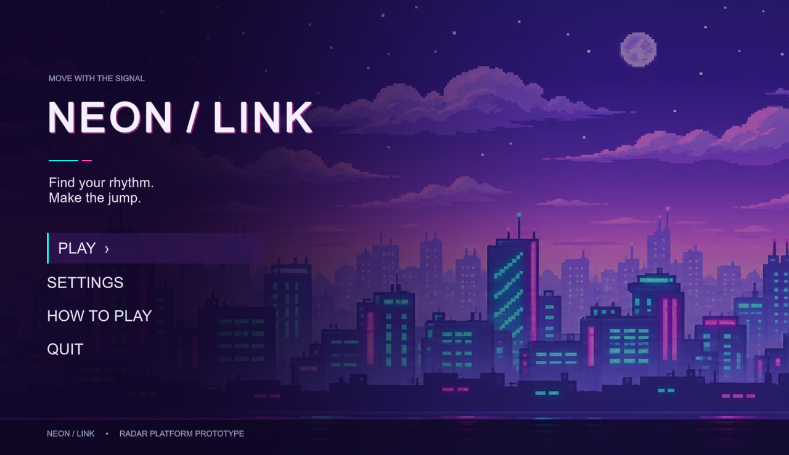
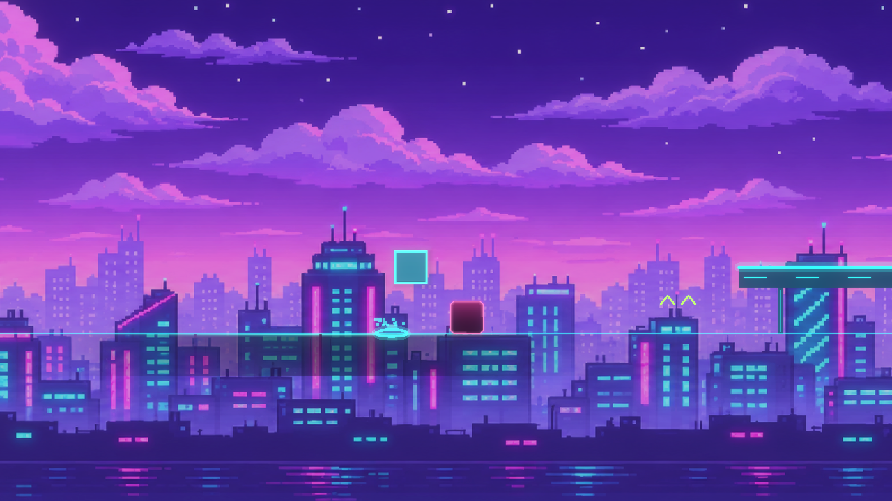

# 25 Kasım 2026 — Kamera ile oynanan NEON / LINK gösterimi

## Hocaya tek cümleyle

Bu hafta kamera görüntüsünden baş ve omuzların birlikte yükselmesini algılayıp Unity'ye zıplama isteği gönderen sistemi oynanabilir hâle getirdik; neon şehir, saydam zemin, üç platformlu parkur ve zıplama efektleri ekledik.

## Verinin oyuna gidişi

```text
Laptop kamerası
  → OpenCV: görüntüyü oku ve göster
  → MediaPipe: baş/omuz noktalarını çıkar
  → CameraGameDetector: referansa göre ortak yükselişi değerlendir
  → GameEventPublisher: localhost UDP 5065'e jump_request gönder
  → JumpPrototype: kaynak/paket/tur/zemin kontrollerini yap
  → Rigidbody2D: yukarı ilk hız ver; yerçekimi hareketi sürdürür
  → NeonStage: kalkış noktasında kıvılcım ve halka göster
```

Hesap API'si ayrı bir hattır: Unity → HTTP localhost:5269 → ASP.NET Core → SQL Server.
Giriş yapma ve kayıtlı sonuçlar bu hattı kullanır. Zıplama komutları API üzerinden gitmez.
Kamera antrenman skoru sonuç ekranında gösterilir; mevcut API'ye kamera turu kaydedilmez.

## Dosya haritası

Yollar depo köküne göredir. Çalışan Unity kaynakları `unity/RadarPlatformGame/Assets/` altındadır.

| Ne anlatılacak? | Dosya / metot | Görevi |
| --- | --- | --- |
| Şehir resmi | `unity/RadarPlatformGame/Assets/Resources/NeonCityBackdrop.png` | Özgün yatay piksel şehir; üretim istemi `docs/art/neon-city-backdrop-prompt.txt` |
| Gökyüzü ve saydamlık | `Assets/Scripts/NeonStage.cs` → `CreateSky`, `CreateCity` | Mor alt katman ve %58 opak şehir resmi |
| Resmin kayması | `NeonStage.LateUpdate`, `FitPanorama` | Kamera ilerlerken daha yavaş kayma; oranı bozmadan ekranı doldurma |
| Giriş / hesap ekranı | `Assets/Scripts/PrototypeInterface.cs` → `LoadBackdrop`, `DrawBackdrop`, `DrawHome`, `DrawAccount` | Aynı resim, yazı altında mor geçiş, form ve düğmeler |
| Karenin hareketi | `Assets/Scripts/JumpPrototype.cs` → `FixedUpdate` | Yatay hızı ve kabul edilen zıplamanın ilk dikey hızını uygular |
| Parkur | `JumpPrototype.Start`, `CreatePlatform`, `CreateObstacle` | Zemin, üç platform ve engellerin fizik konumları |
| Saydam zemin | `JumpPrototype.CreateStageSurface`, `Assets/Resources/ScreenSpotlight2D.shader` | Zemin yüzeyi ve yerel ışık; fizik yüzeyi ayrı collider'dır |
| Engel görünümü | `NeonStage.CreateHazardArt` | İç çizgisiz, pahlı köşeli ve neon kenarlı ortak engel dokusu |
| Zıplama / iniş efekti | `NeonStage.EmitJump`, `EmitBurst`, `LateUpdate` | 12 kısa kıvılcım, genişleyip sönen halka ve hafif iniş efekti |
| Karenin çizimi / dönüşü | `Assets/Scripts/PrototypeCharacter.cs` | Görsel kareyi döndürür; fizik gövdesini döndürmez |
| Zemin teması | `PrototypeCharacter.IsGrounded` | Zemin ve tüm platform parçalarının temasını denetler |
| Kamerayı çalıştırma | `main.py`, `jump_detection/app.py` | OpenCV / MediaPipe döngüsü ve olay gönderimi |
| Kamera hareket kararı | `jump_detection/game_detector.py` | Kalibrasyon, ölçekleme, ortak yükseliş ve yeniden hazır olma |
| UDP gönderimi | `game_bridge/__init__.py` → `GameEventPublisher.send_jump` | Kaynak, sıra ve zaman damgalı JSON olayı |
| UDP kabulü | `JumpPrototype.ReceiveEvents`, `RequestJump` | Seçili kaynak, zaman/sıra ve tur durumunu kontrol eder |
| Hesap / sonuç servisi | `Assets/Scripts/GameAccountClient.cs`, `backend/RadarPlatformGame.Api/` | HTTP oturumu ve desteklenen tur sonuçları |

## Hız, ivme ve zıplama nasıl ayarlanıyor?

`JumpPrototype.cs` başındaki **Hareket ayarları** Unity Inspector'da da görünür.
Serialize edilmiş Inspector değeri varsa kodun başlangıç değerinden önce gelir.

| Değişken | Varsayılan | Anlamı |
| --- | --- | --- |
| `moveSpeed` | 3.25 birim/s | Yatay ilerleme hızı |
| `jumpSpeed` | 11.5 birim/s | Kabul edilen zıplamada ilk yukarı hız |
| `gravityScale` | 2.5 | Unity yerçekimi ivmesini çarpar |
| `CameraAirSpeedMultiplier` | 1.2 | Kamera modunda havada yatay hız 3.9 birim/s olur |
| `FinishX` | 46 | Parkurun bittiği X konumu |

Yatay yönde kademeli ivmelenme yoktur; `FixedUpdate` hedef hızı doğrudan atar.
Dikey ivme `Physics2D.gravity.y * gravityScale` ile oluşur. Proje yerçekimi -9.81 olduğundan
varsayılan aşağı ivme yaklaşık **-24.53 birim/s²** olur. Zıplama başladıktan sonra
Unity bu ivmeyle yükselişi yavaşlatır ve kareyi aşağı çeker.

Oyun her kabul edilen olaya aynı başlangıç hızını verir. Kullanıcının fiziksel zıplama yüksekliği,
karenin zıplama yüksekliğine bire bir çevrilmez. Aynı seviyeye dönüş için yaklaşık yükselme
`jumpSpeed² / (2 * |ivme|)` ile 2.7 birimdir; platforma iniş süresi platformun yüksekliğine bağlıdır.

## Parkur düzeni

Zemin üst yüzeyi Y=-2'dir. Üst yüzey yükseklikleri:

| Bölüm | X aralığı | Y üst yüzey |
| --- | --- | --- |
| İlk platform | 10–18 | -0.4 |
| Daha yüksek ikinci platform | 20–28 | 0.6 |
| Alçak üçüncü platform, ilk parça | 29–32 | -0.65 |
| Alçak üçüncü platform, ikinci parça | 33–36 | -0.65 |

Üçüncü platformda 1 birim boşluk vardır. Engeller X=3.5, 14.5, 24 ve 41'dedir.
Platformlar tek yönlüdür: alttan geçilebilir, üstüne inilince tekrar zıplanabilir.
Zemin altta devam ettiği için platformdan kaçırılan iniş her durumda boşluğa düşmek anlamına gelmez.
Engellerin parıltısı görseldir; çarpışma gövdeleri 0.8 × 0.8 birimdir.

## Kameranın karar mantığı

1. Üst gövde modunda baş ve iki omuz görünür olmalıdır; ayakların görünmesi gerekmez.
2. En az 8 örnek ve 1 saniyelik kararlı duruşla referans alınır.
3. Dikey yer değişimi omuz açıklığına bölünür; kameraya yakınlık etkisi azaltılır.
4. Baş ve iki omuz yeterli hızla, birlikte yükselirse bir olay üretilir.
5. Yeniden olay için referans konuma dönüş, kısa kararlı duruş ve bekleme süresi gerekir.
6. Omuz açıklığı %20'den fazla değişirse yeni mesafede otomatik kalibrasyon yapılır; toplam sayım korunur.

Bu mod üst gövde hareketinden tahmin yapar. Ayakların yerden kesildiği doğrudan ölçülmez;
kullanıcı denemesinde çalışması bütün kişiler ve ortamlar için başarı oranı ölçümü değildir.
Radar kodu korunur; bu haftaki gösterimin ana girdisi **CAMERA**'dır.

## Gösterime başlama

SQL Server ve hesap API'si açık olmalı. Gerekirse ayrı PowerShell'de:

```powershell
Set-Location 'C:\Users\Dila\Documents\JumpDetectionTest\backend\RadarPlatformGame.Api'
dotnet run --launch-profile http
```

Kamera için ikinci PowerShell:

```powershell
Set-Location 'C:\Users\Dila\Documents\JumpDetectionTest'
& '.\.venv\Scripts\python.exe' main.py --game-events --upper-body
```

Unity'de Play → PLAY → SIGN IN → CAMERA → START RUN seçilir.
Kamera `READY - JUMP` gösterince ve geri sayım bitince zıplanır.
İlk uygulanabilir olay kareyi hem zıplatır hem ilerletir. Yeni olay ancak kare zemindeyken
veya platformdayken uygulanabilir; havadaki olay inişte kullanılmak üzere saklanmaz.
`RETRY` yeni tur açar. Başarılı bağlantıda Debug ham UDP, kabul ve uygulanan zıplamayı ayrı gösterir.

## Kontrol sonucu ve sınırları

- 25 Kasım son kontrolde 106 Python testi geçti. Seri port testi `pyserial` kurulumu istemeden sahte portla çalışır.
- .NET API derlemesi 0 hata ve 0 uyarıyla tamamlandı; derleme veritabanına test kaydı yazmaz.
- Yerel, ayrı Unity test projesinde gerçek Physics2D simülasyonu ile simülasyon/radar/kamera
  olayları sırayla verildi; üç platformlu rota sekiz istekle geçildi, havada ikinci zıplama reddedildi.
- Unity'de başlangıç, platform, bitiş, geniş ekran, boş giriş formu ve kıvılcım görüntüleri alınıp incelendi.
- Kullanıcı kamera ile başarılı oyun denemesini bildirdi. Yeni radar donanım deneyi veya nicel kamera doğruluk ölçümü yapılmadı.
- Unity'nin lisanslı CI derlemesi henüz yoktur. GitHub Actions Python kontrollerini ve .NET derlemesini çalıştırır.




