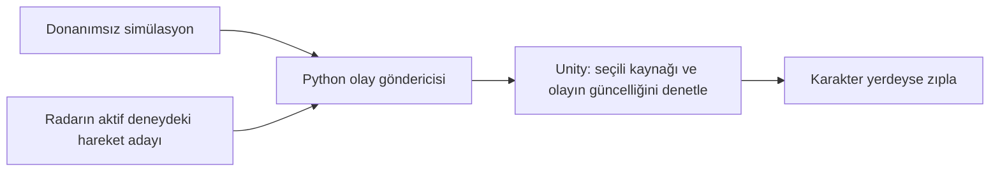

# Python'dan oyuna ilk girdi bağlantısı

Bu ilk prototip yalnız aynı bilgisayarda, `127.0.0.1:5065` adresinde UDP
kullanır. UDP gönderimi, Unity'nin olayı aldığını veya karakterin zıpladığını
doğrulamaz. İlk hedef, algılama kararını oyunun hareketinden ayırabilmektir.



## Tek olayın biçimi

```json
{
  "schema_version": 1,
  "event_type": "jump_request",
  "source": "radar",
  "evidence": "motion_candidate",
  "experimental": true,
  "session_id": "0123456789abcdef0123456789abcdef",
  "sequence": 1,
  "sent_at_unix_ms": 1793606400000
}
```

Örnek zaman sabittir; canlı gönderici her olayda güncel UTC milisaniyesini
yazar. Bu zaman hareketin başlangıcı veya fiziksel gecikme ölçümü değildir.

| Alan | Anlamı |
| --- | --- |
| `event_type` | `jump_request`: oyuna zıplama isteği |
| `source` | `simulator`, `radar` veya gelecekte `camera` |
| `evidence` | Sırasıyla `simulated`, `motion_candidate`, `camera_estimate` |
| `experimental` | Radar/kamera için `true`; simülasyon için `false` |
| `session_id` | Her gönderici oturumunda yeni 32 karakterli küçük harfli onaltılık kimlik |
| `sequence` | Oturumda 1'den başlayıp artan olay sıra numarası |
| `sent_at_unix_ms` | Bilgisayarda gönderim anının UTC milisaniyesi |

Radarın her ölçüm paketi bir olay değildir. Sayaç aktif deneyde yeni aday
saydığında bir olay oluşur. Hazırlıktaki aday gönderilmez. Mevcut radar
denemesi süre sonunda biter; bu henüz kesintisiz oyun kontrol servisi değildir.
Kamera kaynağı sözleşmede ayrılmıştır, kamera uygulaması henüz olay göndermez.

Alıcı yalnız seçilen kaynağı kabul eder. Bozuk/bilinmeyen alanlı, 1000 ms
veya daha eski, 250 ms'den fazla gelecekte görünen, yinelenen veya sıra
numarası geriye giden mesajlar reddedilir. Son 64 oturum takip edilir.
Oyun havadaysa geçerli bir mesaj bile ikinci zıplamayı başlatmaz; istek
saklanıp yere inince kendiliğinden uygulanmaz.

## Donanımsız bağlantı denemesi

Proje kökünde iki terminal açılır. Bu komutlar Python standart kütüphanesini
kullanır; `.venv` veya sistem Python'u kullanılabilir.

Birinci terminal (10 saniye dinler):

```powershell
& ".\.venv\Scripts\python.exe" -m game_bridge listen --seconds 10 --source simulator
```

İkinci terminal:

```powershell
& ".\.venv\Scripts\python.exe" -m game_bridge simulate --count 5 --interval 1
```

Tanı alıcısı beş isteği göstermelidir. Unity açıkken aynı portu tanı
alıcısı da kullanamaz: önce tanı alıcısını kapat, Unity'de Simülasyon
kaynağını seç, aynı göndericiyi yeniden çalıştır.

## Deneysel radar girdisi

Unity sahnesinde Deneysel radar seçilir. Ardından PySerial kurulu sistem
Python'u ile:

```powershell
& "C:\Users\Dila\AppData\Local\Programs\Python\Python312\python.exe" -m radar --counter-window --game-events --port COM5 --seconds 20
```

Radar penceresinde Başlat'a basıp hazırlığın bitmesi beklenir. Yalnız aktif
20 saniyede sayılan adaylar gönderilir. Deneme bittiğinde gönderim durur.
Gönderilen olayın kimliği deneyin `.events.jsonl` kaydında; UDP gönderim
sayısı `.summary.json` içinde saklanır. Bunlar oyunda gerçekleşen zıplama
sayısı veya radarın doğruluk oranı olarak sunulmaz.

Unity 6000.6.7f1 üzerinde klavye, simülasyon ve deneysel radar aktarımı denendi. Son tasarımın hareket/performans doğrulaması ayrıdır. Güncel kurulum ve sınırlar `unity/README.md` ile `docs/2026-11-05-progress.md` içindedir.
